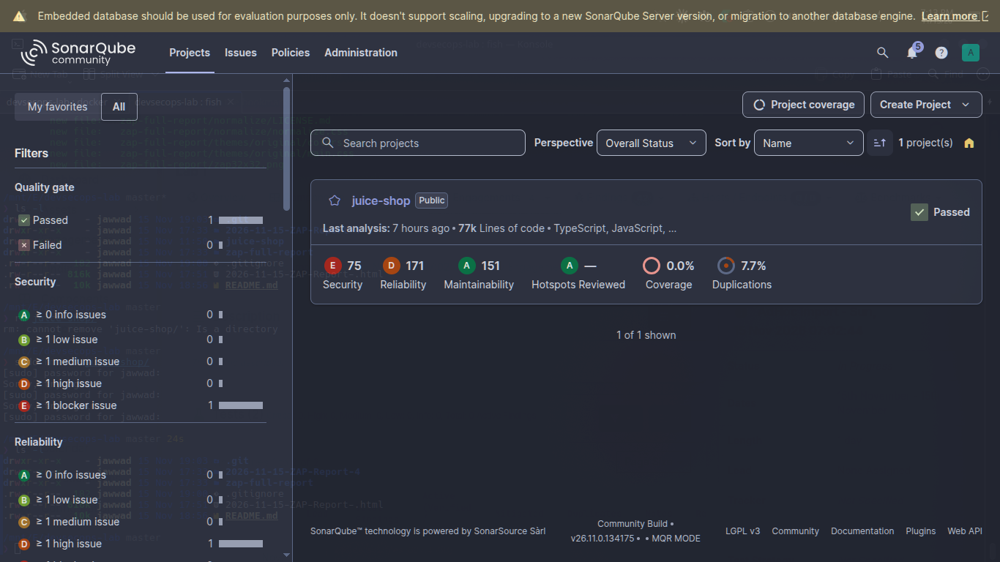
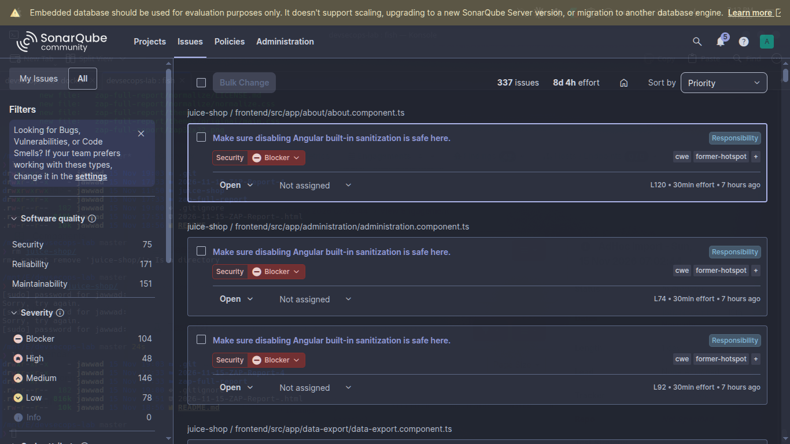
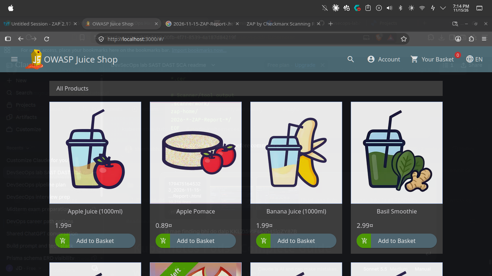
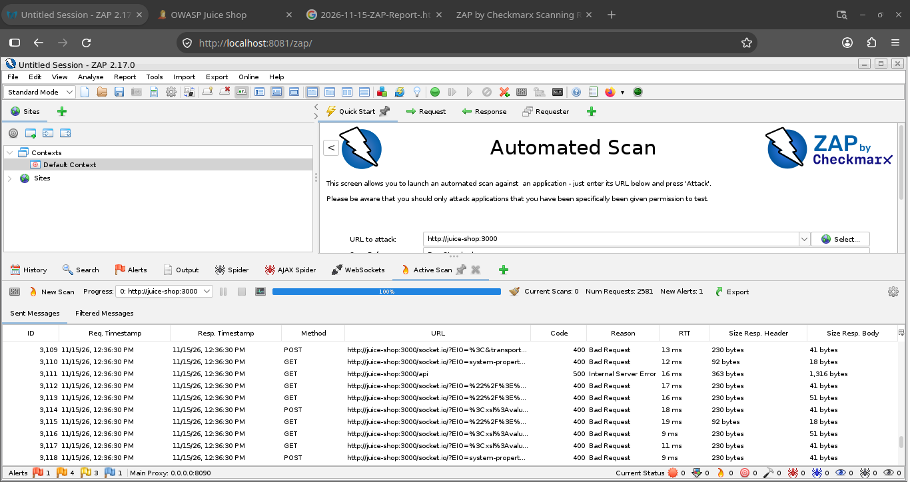
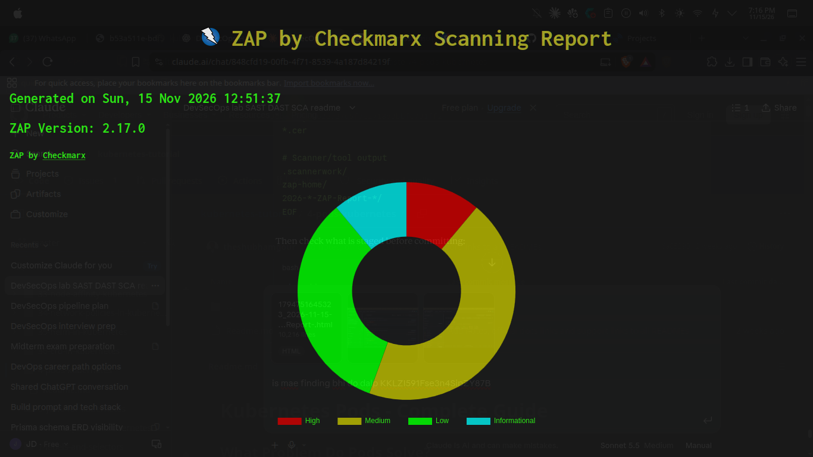

# DevSecOps Security Lab: SAST, DAST and SCA on OWASP Juice Shop

This lab brings together three kinds of security testing using [OWASP Juice Shop](https://github.com/juice-shop/juice-shop), an application built to be intentionally vulnerable. Everything runs in Docker on a local CachyOS machine.

| Practice | Tool | What it tests |
|---|---|---|
| SAST (Static Application Security Testing) | SonarQube Community | Source code, without running it |
| DAST (Dynamic Application Security Testing) | OWASP ZAP | The running application, from outside |
| SCA (Software Composition Analysis) | Trivy | Dependencies, container images and config |

Trivy can also scan container images, secrets, and infrastructure-as-code (IaC), so its role here goes beyond dependency analysis.

## Lab architecture

```
Source code -> SonarQube (SAST) -> Trivy fs (SCA) -> Docker image build
            -> Trivy image scan -> Deploy Juice Shop -> OWASP ZAP (DAST) -> Reports
```

## Environment

- OS: CachyOS (Arch-based) with Docker
- The containers share a Docker network called `devsecops-lab`, which lets them reach each other by name (`sonarqube`, `juice-shop`).
- SonarQube runs on port 9000, Juice Shop on port 3000, and ZAP's Webswing interface on host port 8081.
- DefectDojo is running on the host at port 8080 for importing reports later.

```bash
docker network create devsecops-lab
```

## 1. Setup

### Start SonarQube

```bash
docker run -d --name sonarqube --network devsecops-lab -p 9000:9000 sonarqube:community
```

Open `http://localhost:9000` and sign in with `admin` / `admin`. Change the default password, create a project named `juice-shop`, and generate a project token.

### Start Juice Shop

```bash
docker run -d --name juice-shop --network devsecops-lab -p 3000:3000 bkimminich/juice-shop
```

### Get the source code

A regular clone failed with `curl 92 HTTP/2 stream reset` and `early EOF`; the repository is large, with about 160k objects. A shallow clone worked. Since SCM analysis is disabled in SonarQube, the full Git history isn't needed:

```bash
git clone --depth 1 https://github.com/juice-shop/juice-shop.git
```

If the clone fails again, try `git config --global http.version HTTP/1.1` or download the ZIP of the master branch.

## 2. SAST with SonarQube

### Scanner configuration

The scanner reads its settings from `sonar-project.properties` in the project root. That keeps the Docker command focused on running the scan:

```properties
sonar.projectKey=juice-shop
sonar.sources=.
sonar.exclusions=node_modules/**,frontend/dist/**,build/**,dist/**,test/**
sonar.tests=test
sonar.scm.disabled=true
```

### Scan command

```bash
export SONAR_TOKEN="YOUR_PROJECT_TOKEN"

docker run --rm \
  --network devsecops-lab \
  -u "$(id -u):$(id -g)" \
  -e SONAR_HOST_URL=http://sonarqube:9000 \
  -e SONAR_TOKEN \
  -v "$PWD:/usr/src" \
  sonarsource/sonar-scanner-cli:11 \
  -Dsonar.qualitygate.wait=true
```

Here's what the main options do:

| Option | Purpose |
|---|---|
| `--rm` | Delete the container when it exits |
| `--network devsecops-lab` | Join the network so `sonarqube` resolves |
| `-u "$(id -u):$(id -g)"` | Run as your user so `.scannerwork` is not owned by root |
| `-e SONAR_TOKEN` | Pass the token from the shell, keeping it out of the command text and shell history |
| `-v "$PWD:/usr/src"` | Mount the source code where the scanner looks for it |
| `sonar-scanner-cli:11` | Pinned scanner version for repeatable results |
| `sonar.qualitygate.wait=true` | Wait for the quality gate and exit non-zero if it fails (useful in CI) |

### Issues encountered

| Error | Cause | Fix |
|---|---|---|
| `You must define the following mandatory properties: sonar.projectKey` (log showed `Project root configuration file: NONE`) | No `sonar-project.properties`, and no `-D` flags | Created the properties file |
| `File test/api/basket.test.ts can't be indexed twice` | `sonar.sources=.` already includes `test/`, and `sonar.tests=test` includes it again; main and test files must be disjoint | Added `test/**` to `sonar.exclusions` (or drop the `sonar.tests` line) |

### Results (scan of 2026-11-15)

I scanned the `juice-shop` project at `http://localhost:9000` with the configuration above. SonarQube processed 1,690 files and detected 10 languages.

| Metric | Result |
|---|---|
| Quality gate | Passed |
| Lines of code | 77k (TypeScript, JavaScript, ...) |
| Security | 75 issues, rating **E** (at least one blocker issue) |
| Reliability | 171 issues, rating **D** |
| Maintainability | 151 issues, rating **A** |
| Security hotspots reviewed | none yet |
| Coverage | 0.0% (no coverage report was imported) |
| Duplications | 7.7% |
| Total on the Issues page | 337 |

The Issues page showed 104 Blocker, 48 High, 146 Medium, 78 Low, and 0 Info issues. In MQR mode, one issue can count against more than one software quality, so the severity and quality totals won't necessarily add up to the 337 issues shown overall.

The quality gate passed despite the blocker issues, which surprised me. One possible explanation is that the default gate checks only new code, so a first scan may still pass. Before using this as a CI gate, verify the gate conditions and the project's New Code setting.

The dashboard screenshot shows the passed gate and the issue, coverage, and duplication metrics above. I also opened the Juice Shop storefront at `http://localhost:3000/` to confirm it was running locally.

**Task 1: SonarQube findings.** I looked for at least three security findings and noted why SonarQube flagged them.

| # | Finding | Location | Why it was reported |
|---|---|---|---|
| 1 | Make sure disabling Angular built-in sanitization is safe here (Security, Blocker, tags `cwe`, `former-hotspot`, about 30 min effort) | `frontend/src/app/about/about.component.ts`, line 120 | Angular escapes untrusted values by default. Code that turns this off for a value (typically through the `DomSanitizer` bypass methods) becomes an XSS risk if any user-controlled data reaches it |
| 2 | Same rule | `frontend/src/app/administration/administration.component.ts`, lines 74 and 92 | Same reason, two more places in one file |
| 3 | Same rule | `frontend/src/app/data-export/data-export.component.ts` (line not captured) | Same reason |

All three findings come from the same rule, in different parts of the code. To get a broader view, filter the Issues page by Security and look for findings from other rules too. Juice Shop is intentionally vulnerable, so these may be part of its XSS challenges. In a real application, I'd trace each value to see whether a user could control it.

## 3. SCA with Trivy

Run these commands from the `juice-shop` folder:

```bash
# Full filesystem scan
docker run --rm -v "$PWD:/work" -w /work aquasec/trivy:latest \
  fs --scanners vuln,misconfig,secret .

# High and critical vulnerabilities only
docker run --rm -v "$PWD:/work" -w /work aquasec/trivy:latest \
  fs --scanners vuln --severity HIGH,CRITICAL .

# JSON report
docker run --rm -v "$PWD:/work" -w /work aquasec/trivy:latest \
  fs --scanners vuln -f json -o trivy-report.json .
```

For each finding, record the package, installed and fixed versions, CVE ID, and severity.

**Interview question: What's the difference between SAST and SCA?**
SAST looks for security issues in your own source code. SCA checks third-party dependencies for known vulnerabilities.

Status: _fill in results and the date you ran it._

## 4. DAST with OWASP ZAP

### Baseline and full scan (CLI)

```bash
# Passive baseline scan
docker run --rm --network devsecops-lab -v "$PWD:/zap/wrk/:rw" \
  ghcr.io/zaproxy/zaproxy:stable \
  zap-baseline.py -t http://juice-shop:3000 -r zap-report.html

# Active full scan
docker run --rm --network devsecops-lab -v "$PWD:/zap/wrk/:rw" \
  ghcr.io/zaproxy/zaproxy:stable \
  zap-full-scan.py -t http://juice-shop:3000 -r zap-full-report.html
```

Run active scans only against your own lab application or systems you have explicit permission to test.

### Running ZAP with its GUI in the browser

I ran ZAP's desktop interface through Webswing so I could watch the spider, alerts, and scan progress:

```bash
docker run --rm -u zap \
  --network devsecops-lab \
  -p 8081:8080 \
  -v "$PWD:/zap/wrk/:rw" \
  ghcr.io/zaproxy/zaproxy:stable \
  zap-webswing.sh
```

Open `http://localhost:8081/zap/`. I used port 8081 because DefectDojo already uses 8080. In ZAP, set the target to `http://juice-shop:3000`, not `localhost`: inside the ZAP container, `localhost` points back to ZAP itself.

### Problem: only GET requests were scanned

This happened because the standard spider follows links, while Juice Shop is an Angular single-page app. Its login, basket, and feedback actions use JavaScript REST calls, and unauthenticated scans can't reach pages behind login.

To reach more of the application:

1. Enable the AJAX spider with a headless browser.
2. Use **Manual Explore**: launch the browser from ZAP, then register, log in, add basket items, send feedback and check out so ZAP records the POST/PUT/DELETE calls.
3. Run **Attack > Active Scan** on `http://juice-shop:3000` in the Sites tree afterwards.
4. For authenticated testing, define a Context and User, or use Forced User mode.

### Problem: report generation

| Symptom | Cause | Fix |
|---|---|---|
| Browser pop-up blocked on Generate Report | Webswing tries to open the report in a new window | Ignore it; the report file is still written. Save to a directory and open from the host |
| Report not found in the mounted folder | Report Directory defaulted to `/home/zap/` inside the container, not `/zap/wrk/` | Copy it out with `docker cp` |
| `docker cp` said file not found | The named file had not been generated yet | List `/home/zap` first with `docker exec <container> ls -lt /home/zap` |
| HTML opens with no styling | The Modern template loads CSS/JS from an assets folder, and the HTML references it by exact name. ZAP adds a number to that name when older folders exist, so this report pointed at `2026-11-15-ZAP-Report-4/`, not `2026-11-15-ZAP-Report-` | Find the name with `grep -o 'href="[^"]*"' <report>.html`, then copy that exact folder next to the HTML |

The container was started with `--rm`, so copy the report files out before stopping it:

```bash
docker exec <container> ls -lt /home/zap

# Modern template: copy the HTML and the assets folder it references (check the exact name, see below)
docker cp <container>:/home/zap/2026-11-15-ZAP-Report-.html ./
docker cp <container>:/home/zap/2026-11-15-ZAP-Report- ./
```

Keep the HTML filename unchanged: it looks for an assets folder with a matching name, which may include a number suffix. This report referenced `2026-11-15-ZAP-Report-4/`, so that exact folder needs to sit beside the HTML file:

```bash
docker cp <container>:/home/zap/2026-11-15-ZAP-Report-4 ./
```

Keep the HTML file and its assets folder in the same directory.

To create a single self-contained HTML file, use **Report > Generate Report**, choose **Traditional HTML Report**, set the report name to `zap-full-report` and the report directory to `/home/zap/`, then run:

```bash
docker cp <container>:/home/zap/zap-full-report.html ./
```

For DefectDojo, generate a **Traditional XML Report** or a JSON report as well.

The report was generated in the container and copied to the host with its assets folder. It opens with the styling intact.

### Results (active scan, report generated 2026-11-15 12:51 UTC)

I scanned `http://juice-shop:3000` with ZAP 2.17.0. The active scan reached 100% after 2,581 requests and reported nine alerts:

| Risk | Alert | Instances |
|---|---|---|
| High | SQL Injection | 1 |
| Medium | Content Security Policy (CSP) Header Not Set | Systemic |
| Medium | Cross-Domain Misconfiguration | Systemic |
| Medium | Missing Anti-clickjacking Header | 1 |
| Medium | Session ID in URL Rewrite | Systemic |
| Low | Private IP Disclosure | 1 |
| Low | Timestamp Disclosure - Unix | 4 |
| Low | X-Content-Type-Options Header Missing | 3 |
| Info | Modern Web Application | Systemic |

The report lists 124 endpoints. Of the requests, 99% were `GET`; 54% of responses were 4xx (mostly malformed payloads from the active scan), and 2% were 5xx. That high `GET` share confirms the scan barely reached authenticated routes or the `POST`/`PUT` APIs for login, baskets, and orders. To cover those paths, log in through ZAP's browser, use the app, and scan again.

The Webswing screenshot shows the scan at 100% after 2,581 requests. The table below summarizes the finished report. ZAP's **New Alerts** counter shows alerts added during that scan, so it may differ from the report's total.

**Task 2: ZAP findings.** I chose three alerts and recorded their risk, evidence, and suggested remediation.

| # | Alert | Risk | Evidence | Remediation |
|---|---|---|---|---|
| 1 | SQL Injection | High | `GET /rest/products/search?q=%27%28`, parameter `q`, attack `'(`. The server answered `500` and leaked `SQLITE_ERROR: near "(": syntax error` together with the full SQL statement (`SELECT * FROM Products WHERE ((name LIKE ...`). CWE-89, OWASP A03:2021 | Use parameterised queries or prepared statements, never concatenate input into SQL, validate input with an allow-list, run the app with a least-privilege database user, and do not return raw database errors to the client |
| 2 | Content Security Policy (CSP) Header Not Set | Medium | No `Content-Security-Policy` header on `http://juice-shop:3000` and other pages (flagged systemic). CWE-693 | Configure the web server or application to send a CSP header, which limits where scripts and other content may load from and reduces XSS impact |
| 3 | Cross-Domain Misconfiguration | Medium | `Access-Control-Allow-Origin: *` on `/`, `/robots.txt`, `/sitemap.xml`, `/styles.css` and the favicon. CWE-264 | Restrict the header to the specific origins that need it, or remove CORS headers so the browser enforces the Same Origin Policy |

The remaining alerts:

- **Session ID in URL Rewrite (Medium):** the Socket.IO `sid` value travels in the query string (CWE-598). Session IDs in URLs can leak through the Referer header, browser history and server logs; use a cookie instead.
- **Missing Anti-clickjacking Header (Medium):** a `POST /socket.io/` response had no `X-Frame-Options` or CSP `frame-ancestors`. Set one of them.
- **Private IP Disclosure (Low):** `/rest/admin/application-configuration` returns internal addresses such as `192.168.99.100:3000`. That request carried no cookie or auth header and still returned `200` with the whole application configuration, which is worth investigating as an access-control problem.
- **Timestamp Disclosure - Unix (Low):** Unix timestamps in the configuration and product search responses. Low risk; confirm they are not sensitive.
- **X-Content-Type-Options Header Missing (Low):** Socket.IO responses lack `nosniff`.
- **Manual observation (no alert):** `robots.txt` lists `Disallow: /ftp`, and `/ftp` shows a directory listing with backup and key-store filenames. ZAP didn't flag this, but it appears in the captured response.

### What the tools found

- **SAST (SonarQube)** flagged risky patterns in the Angular frontend, including sanitization bypasses, without running the application.
- **DAST (ZAP)** found a SQL injection at runtime and missing or permissive HTTP headers, issues a source-only scan can't observe.
- **SCA (Trivy)** checks dependencies for known vulnerabilities, an area the other two tools don't cover. I haven't run it yet.

## Screenshots

### SonarQube dashboard



### SonarQube issues



### Juice Shop running locally



### ZAP active scan



### ZAP report



## 5. Expected outputs

- SonarQube project dashboard for `juice-shop`
- `trivy-report.json`
- `zap-report.html` (baseline)
- `zap-full-report.html` (full or active scan)

## 6. Progress checklist

- [x] Install and verify Docker
- [x] Start SonarQube and create a project
- [x] Deploy Juice Shop locally
- [x] Configure the SonarQube scan and fix indexing errors
- [x] Run ZAP with its GUI and generate a report
- [x] Review SonarQube findings (Task 1)
- [x] Run Trivy filesystem and dependency scan
- [x] Investigate CVEs and fixed versions
- [x] Run ZAP baseline scan
- [x] Run ZAP active scan after Manual Explore
- [x] Document findings (Task 2)

## 7. Next steps

1. Fix a few findings from each tool and re-scan to confirm they disappear.
2. Import the XML/JSON reports into DefectDojo.
3. Only then integrate all three tools into a Jenkins pipeline, using the SonarQube quality gate (`sonar.qualitygate.wait=true`) as a pipeline gate.

## Security notes

- Never commit tokens. Keep `SONAR_TOKEN` in an environment variable or an untracked `.env` file.
- Juice Shop is deliberately vulnerable. Do not expose it to the internet.
- Run DAST only on systems you own or have permission to test.